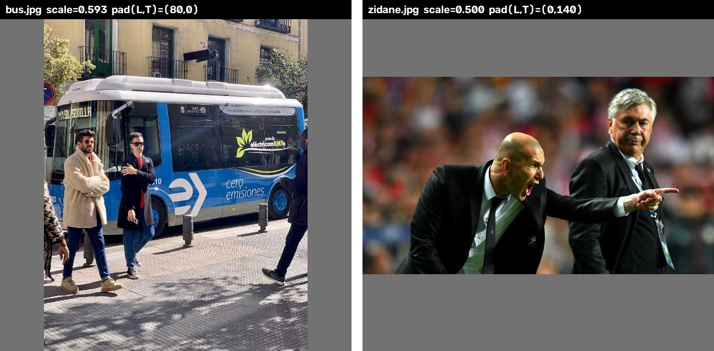
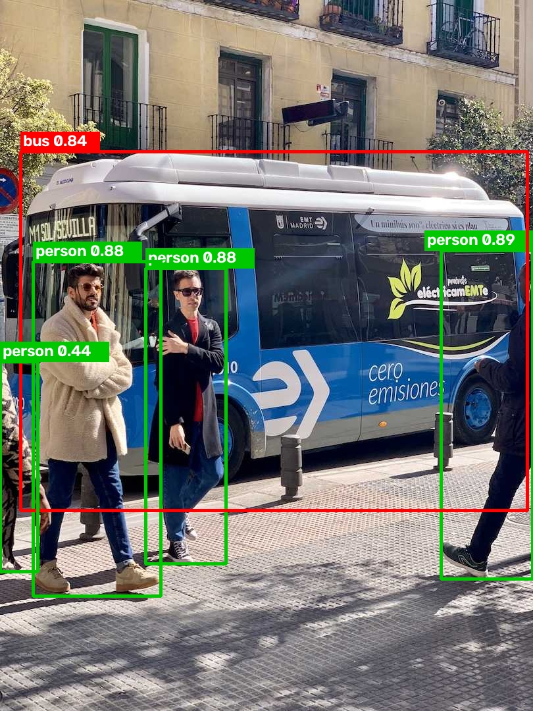

 이번 목표는 ultralytics에 기대지 않고 사진 한 장을 넣어 박스가 나오기까지의 전 과정을 내 손으로 짜 보는 것이었다.\\
 The goal this time was to write the whole path from a single image to output boxes by hand, without relying on ultralytics.

---

## letterbox는 세로 사진 하나로는 검증이 안 됐다

전처리의 첫 단계는 letterbox다. 비율을 유지한 채 긴 변을 640에 맞추고, 남는 칸은 회색(114)으로 채워서 물체가 찌그러지지 않게 하는 방식이다. 축소 비율은 `scale = min(640/h, 640/w)`로 잡았다. 더 많이 줄여야 하는 쪽을 기준으로 해야 하고, max를 쓰면 한 변이 640을 넘어 잘려 버린다.\\
The first preprocessing step is letterbox. It fits the long side to 640 while keeping the aspect ratio and fills the leftover area with gray (114) so objects don't get squashed. I set the ratio as `scale = min(640/h, 640/w)`. It has to follow the side that needs more shrinking; using max would push one side past 640 and crop it.

처음 짠 코드에서 패딩을 `bottom = size - top`으로 계산했다. 그런데 bus.jpg(1080 × 810, 세로 사진)로 돌려보니 결과가 멀쩡해 보였다. 세로 사진은 좌우에만 패딩이 들어가고 위아래로 남는 칸이 0이라, 틀린 식이 우연히 맞는 값을 내고 있었던 것이다. 가로 사진인 zidane.jpg(720 × 1280)를 넣고 나서야 위아래 패딩이 이상하다는 걸 알았다. 전체 640이 아니라 남는 칸에서 top을 빼야 했고, `bottom = size - new_h - top`으로 고쳤다.\\
My first version computed padding as `bottom = size - top`. Running it on bus.jpg (1080 × 810, portrait), the result looked fine. A portrait image only gets left/right padding and has zero leftover vertically, so the wrong formula happened to produce the right value. Only after feeding the landscape zidane.jpg (720 × 1280) did I notice the top/bottom padding was off. I needed to subtract top from the leftover space, not from the full 640, so I fixed it to `bottom = size - new_h - top`. 

bus.jpg는 scale 0.593에 좌우 패딩 80, zidane.jpg는 scale 0.5에 위아래 패딩 140이 나왔다. letterbox 함수가 이미지와 함께 scale과 pad를 같이 반환하게 만든 건, 모델이 내놓는 박스가 640 letterbox 좌표라서 나중에 원본 좌표로 되돌릴 때 이 두 값이 꼭 필요하기 때문이다.\\
bus.jpg came out with scale 0.593 and 80 px of left/right padding, and zidane.jpg with scale 0.5 and 140 px of top/bottom padding. I made the letterbox function return scale and pad along with the image because the model's boxes are in 640 letterbox coordinates, and these two values are needed to map them back to the original image.



---

## cv2는 원본을 바꾸지 않는다

letterbox 다음은 BGR → RGB 변환, `/255` 정규화, HWC → CHW 축 변환, 배치 축 추가 순서다. 단계마다 shape와 dtype을 찍어가며 진행했고, 마지막에 `(1, 3, 640, 640) float32`, 값 범위 0.0~1.0이 나왔다.\\
After letterbox come BGR → RGB conversion, `/255` normalization, HWC → CHW transpose, and adding the batch axis. I printed shape and dtype at every step, and ended up with `(1, 3, 640, 640) float32` in the 0.0–1.0 range. 

이 과정에서 자잘하게 걸린 것들이 있었다. `cv2.resize`는 shape가 `(H, W)`인데 크기 인자는 `(W, H)` 순서로 받고, 크기는 정수여야 해서 `round(w * scale)`로 넘겨야 했다. 나중에 후처리에서 `np.clip`, `np.argsort`를 쓸 때도 똑같은 실수를 반복할 뻔했다.\\
There were a few small snags along the way. `cv2.resize` takes the size argument as `(W, H)` even though shapes are `(H, W)`, and the size has to be an integer, so I passed `round(w * scale)`. I nearly made the same mistake again later with `np.clip` and `np.argsort` in post-processing.

RasEyes에서는 `rknn.config()`에 mean/std를 넣어두면 NPU가 정규화까지 알아서 해줬다. ONNX Runtime에는 그런 기능이 없어서 이번엔 직접 했는데, 결국 RasEyes에서 카메라 프레임 → letterbox → NPU 입력으로 하던 전처리를 손으로 다시 짠 셈이다.\\
In RasEyes, putting mean/std into `rknn.config()` let the NPU handle normalization on its own. ONNX Runtime has no such feature, so I did it myself this time; in effect I rewrote by hand the camera frame → letterbox → NPU input preprocessing that RasEyes used to do.

---

## 추론 시간이 실행할 때마다 달랐다

CPU 8코어, FP32 기준으로 워밍업 3회 후 20회를 측정했다. 전처리는 약 2 ms였고, 추론은 최소 약 29 ms였다. 이상했던 건 한 번 실행 안에서는 평균과 최소가 거의 같게 안정적인데, 프로그램을 다시 돌리면 평균이 30 ms였다가 50 ms였다가 한다는 점이었다.\\
On an 8-core CPU in FP32, I measured 20 runs after 3 warm-ups. Preprocessing took about 2 ms, and inference had a minimum of about 29 ms. The odd part was that within a single run the mean and minimum were nearly identical and stable, yet rerunning the program moved the mean between 30 ms and 50 ms.

원인 후보로는 CPU 거버너가 `powersave`라 클럭이 오르내리는 것, 그리고 스레드 배치 정도를 의심하고 있다. 확실히 짚지는 못했지만, 벤치마크는 한 번 돌린 숫자 하나가 아니라 여러 번 돌려서 범위로 기록해야 한다는 건 확실히 배웠다. 돌이켜보면 Orange Pi에서 측정값이 흔들렸던 것도 클럭이나 발열 쓰로틀링을 먼저 의심해봤어야 했다.\\
My suspects are the CPU governor being on `powersave` (so the clock fluctuates) and thread placement. I couldn't pin it down, but I definitely learned that a benchmark should be recorded as a range over several runs, not as a single number. Looking back, when measurements wobbled on the Orange Pi, I should have suspected clock or thermal throttling first.

---

## 물체는 5개인데 후보는 46개

`(84, 8400)` 출력에서 후보마다 80개 클래스 중 최고 점수와 그 클래스 번호를 뽑고, 0.25를 넘는 것만 남겼다. 같은 mask를 점수·클래스·박스에 전부 적용해야 후보 번호가 어긋나지 않고, 박스는 2차원이라 `pred[:4, mask]`로 걸렀다. 그렇게 남은 후보가 46개였다. bus.jpg에 물체는 5개뿐인데 말이다. 이웃한 격자 칸들, 그리고 80/40/20 서로 다른 격자가 같은 물체에 동시에 반응하기 때문인데, 이게 NMS가 필요한 이유다.\\
From the `(84, 8400)` output I took each candidate's best score among the 80 classes and its class index, and kept only those above 0.25. The same mask has to be applied to scores, classes, and boxes so the candidate indices stay aligned, and since boxes are 2-D I filtered them with `pred[:4, mask]`. That left 46 candidates, even though bus.jpg has only 5 objects. Neighboring grid cells and the different 80/40/20 grids all respond to the same object at once, and that is exactly why NMS is needed.

NMS 전에 박스를 `cx, cy, w, h`에서 `x1, y1, x2, y2`로 바꿨다. 이미지 y축은 아래로 갈수록 커지니까 위쪽 모서리가 `cy - h/2`다. 그다음 letterbox를 되돌렸는데, 전처리가 `× scale → + pad`였으니 되돌리기는 역순으로 `- pad → ÷ scale`이다. 마지막으로 원본 크기에 맞춰 clip을 했다. 패딩 영역에 걸친 박스가 음수나 810을 넘는 값으로 삐져나가기 때문인데, 실제로 46개 중 x가 0.0과 810.0에서 잘리는 게 보였다.\\
Before NMS I converted boxes from `cx, cy, w, h` to `x1, y1, x2, y2`. Image y grows downward, so the top edge is `cy - h/2`. Then I undid the letterbox: preprocessing was `× scale → + pad`, so the inverse is the reverse order, `- pad → ÷ scale`. Finally I clipped to the original size, since boxes overlapping the padding spill out as negatives or values over 810; among the 46 I could actually see x getting clipped at 0.0 and 810.0.

점수 0.89로 1등이었던 사람 박스는 640 좌표에서 `x2 = 560`이었다. 640에서 패딩 80을 뺀 값, 즉 실제 사진의 오른쪽 끝이다. 원본 좌표로 되돌리니 `x2 ≈ 809.9`로 원본 너비 810에 붙었다. 사진 오른쪽 끝에 몸이 반쯤 잘린 사람이었고, 숫자가 그림과 맞아떨어지는 걸 보니 좌표 변환은 제대로 됐다고 확신할 수 있었다.\\
The top-scoring person box (0.89) had `x2 = 560` in 640 coordinates — 640 minus the 80 padding, i.e. the right edge of the actual photo. Mapped back to the original it became `x2 ≈ 809.9`, right against the 810 width. It was a person half cut off at the photo's right edge, and seeing the numbers line up with the picture convinced me the coordinate conversion was correct.

---

## IoU

NMS의 핵심인 IoU는 `겹친 넓이 / (넓이1 + 넓이2 − 겹친 넓이)`다. 겹친 영역은 왼쪽·위는 두 박스의 x1·y1 중 max, 오른쪽·아래는 x2·y2 중 min으로 구한다. 여기서 조심할 부분은 안 겹치는 경우의 처리다. 가로·세로 길이를 곱한 다음에 `max(0, 곱)`을 하면, x로도 떨어지고 y로도 떨어진 박스는 음수 × 음수 = 양수가 되어 겹친 걸로 나온다. 그래서 가로와 세로를 각각 0으로 막은 다음에 곱했다.\\
IoU, the heart of NMS, is `overlap / (area1 + area2 − overlap)`. The overlap's left/top is the max of the two boxes' x1/y1, and its right/bottom is the min of x2/y2. The tricky part is the non-overlapping case. If you multiply width and height first and then take `max(0, product)`, two boxes separated in both x and y give negative × negative = positive and look like they overlap. So I clamped width and height to 0 separately before multiplying.

이게 맞는지 확인하려고 기대값을 미리 정해둔 케이스들을 만들었다. 똑같은 박스는 1.0, 반만 겹치는 `[0,0,10,10]`과 `[5,0,15,10]`은 50 / 150 = 0.333, 안에 쏙 들어가는 `[2,2,8,8]`은 0.36, 대각선이나 x로만·y로만 떨어진 박스는 0이다. 특히 한쪽으로만 떨어진 경우에 음수 IoU가 나오면 버그라고 정해두니 확인이 편했다.\\
To check it, I wrote cases with expected values decided in advance: identical boxes give 1.0, half-overlapping `[0,0,10,10]` and `[5,0,15,10]` give 50 / 150 = 0.333, a box fully inside, `[2,2,8,8]`, gives 0.36, and boxes separated diagonally or only along x or y give 0. Deciding up front that a negative IoU in the one-axis cases means a bug made the check easy.

---

## NMS를 돌리니 46개가 5개가 됐다

NMS는 점수 높은 순으로 줄 세운 뒤, 1등을 남기고 1등과 많이 겹치는 후보를 지우는 걸 반복하는 방식이다.\\
NMS sorts candidates by score, keeps the top one, removes candidates that overlap it heavily, and repeats.

```python
def nms(boxes, scores, iou_thres=0.45):
    h2l = list(np.argsort(scores)[::-1])     # 점수 높은 순 칸 번호
    keep = []
    while len(h2l) > 0:
        best = h2l[0]
        keep.append(best)
        h2l = [j for j in h2l[1:] if iou(boxes[best], boxes[j]) < iou_thres]
    return keep
```

`np.argsort`는 오름차순 인덱스를 돌려주기 때문에 `[::-1]`로 뒤집어야 한다. 리스트 컴프리헨션에서는 1등과 덜 겹친, 즉 다른 물체일 수도 있는 박스만 다음 라운드로 넘긴다. 돌려보니 46개가 정확히 5개(사람 4, 버스 1)로 줄었다.\\
`np.argsort` returns ascending indices, so it has to be flipped with `[::-1]`. The list comprehension passes only boxes that overlap the winner less — ones that might be different objects — to the next round. Running it reduced the 46 candidates to exactly 5 (4 people, 1 bus).



---

## ultralytics와 소수점까지 맞았다

마지막으로 같은 `yolov8n.onnx`를 `YOLO("yolov8n.onnx", task="detect")`로 불러 ultralytics 결과와 비교했다. 같은 모델을 써야 전처리·후처리의 차이만 볼 수 있어서다.\\
Finally I loaded the same `yolov8n.onnx` with `YOLO("yolov8n.onnx", task="detect")` and compared against ultralytics. Using the same model is what lets me isolate differences in pre- and post-processing.

| 내 코드 (My code) | ultralytics | 점수 (Score) | 클래스 (Class) |
|---|---|---|---|
| 670.4, 380.6, 809.9, 879.7 | 670.45, 380.56, 809.92, 879.65 | 0.890 | person |
| 221.7, 407.4, 343.8, 856.2 | 221.68, 407.42, 343.78, 856.19 | 0.883 | person |
| 50.7, 397.3, 244.4, 905.4 | 50.68, 397.30, 244.40, 905.38 | 0.878 | person |
| 31.5, 230.7, 801.4, 775.8 | 31.49, 230.74, 801.41, 775.78 | 0.843 | bus |
| 0.4, 549.8, 57.8, 868.3 | 0.45, 549.84, 57.77, 868.30 | 0.436 | person |

다섯 개 모두 반올림 차이 말고는 똑같았다. \\
All five matched apart from rounding. 

다만 결과가 같다고 구현이 같은 건 아니었다. 내 NMS는 클래스를 무시하고 IoU만 보는 agnostic 방식이라, 사람과 버스도 많이 겹치면 지워버린다. ultralytics 기본값은 `agnostic_nms=False`로 클래스별로 따로 NMS를 한다. 이번에 결과가 같았던 건 버스와 사람들 사이의 IoU가 0.014~0.165로 0.45보다 훨씬 작았기 때문이다. 사람이 버스 앞에 서 있어도 버스가 워낙 커서 분모인 합친 넓이가 커지니 IoU가 작게 나온 것이다. 큰 물체 앞에 꽉 차게 서 있는 사람처럼 다른 클래스끼리 IoU가 높은 상황이라면 내 코드는 멀쩡한 박스를 지울 수 있다.\\
But matching results didn't mean matching implementations. My NMS is agnostic — it ignores class and looks only at IoU — so it would drop a person and a bus that overlap heavily. ultralytics defaults to `agnostic_nms=False` and runs NMS per class. The results matched this time because the IoU between the bus and the people was 0.014–0.165, far below 0.45. Even with people standing in front of the bus, the bus is so large that the union (the denominator) grows and IoU stays small. In a case where different classes overlap heavily, like a person filling the frame in front of a large object, my code could delete a valid box.

RasEyes와 비교하면, RKNN 출력은 격자 3개가 따로 나왔고 이번 ONNX는 이미 Concat된 `(84, 8400)`이었다. 디코딩하는 위치만 다를 뿐 거르기와 NMS 흐름은 같다는 걸 이번에 직접 짜보면서 확인할 수 있었다.\\
Compared with RasEyes, the RKNN output came as three separate grids, while this ONNX output was already concatenated into `(84, 8400)`. Writing it myself this time confirmed that only the place where decoding happens differs; the filtering and NMS flow are the same.

---

## 다음 진행할 내용

이번에 비교용으로 만든 `compare.py`는 지우지 않고 남겨뒀다. 다음에는 모델을 INT8로 양자화해 볼 생각인데, 그때 이 스크립트로 FP32와 INT8 결과가 얼마나 달라지는지 박스 단위로 비교해볼 것이다. 추론 시간도 이번에 배운 대로 여러 번 돌려 범위로 기록해서 FP32와 나란히 놓고 볼 계획이다.\\
I kept the `compare.py` I wrote for this comparison instead of deleting it. Next I plan to quantize the model to INT8 and use this script to compare, box by box, how much the INT8 results differ from FP32. I'll also record inference time as a range over several runs, as I learned this week, and put it side by side with FP32.
