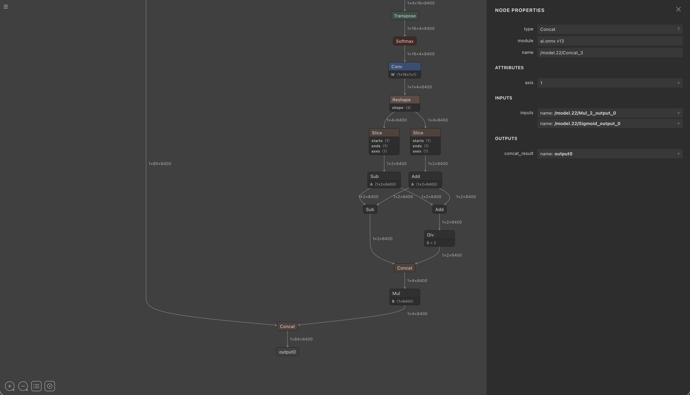

지난주에 손으로 짠 FP32 추론을 이번 주에는 INT8로 바꿔 보는 게 목표였다. 그 전에 양자화가 정확히 뭘 하는 건지부터 숫자로 확인하고 넘어가고 싶었다.\\
This week's goal was to turn last week's hand-written FP32 inference into INT8. Before that, I wanted to see in actual numbers what quantization really does.

---

## 결국 모든 게 scale 한 줄로 설명된다

양자화 공식 자체는 단순하다. 실수 `x`를 `scale`로 나눠 반올림하고 `zero_point`만큼 밀어서 정수 범위 안에 자르면 끝이고, 되돌릴 때는 `(q - zero_point) * scale`을 하면 된다. scale은 정수 한 칸이 실수로 얼마인지, 즉 실수 범위 폭을 정수 범위 폭으로 나눈 값이고, zero_point는 범위의 시작이 어느 정수에 대응하는지를 나타낸다.\\
The quantization formula itself is simple: divide the real value `x` by `scale`, round it, shift it by `zero_point`, and clip it into the integer range. To go back, compute `(q - zero_point) * scale`. The scale is how much one integer step is worth in real units — the real range width divided by the integer range width — and the zero_point says which integer the start of the range maps to.

처음에는 PTQ와 QAT, 대칭과 비대칭, per-tensor와 per-channel, calibration 같은 용어가 따로따로 외워야 할 것처럼 보였다. 그런데 정리하다 보니 결국 한 줄로 모였다. round는 가장 가까운 눈금으로 옮기는 거라 최악의 오차는 두 눈금의 딱 중간, 즉 scale의 절반이다. 그러니 범위를 좁게 잡을수록 scale이 작아지고 정밀해진다. 나머지 개념은 전부 "범위를 어떻게 좁게 잡을 것인가"에 대한 서로 다른 답이었다.\\
At first, terms like PTQ vs QAT, symmetric vs asymmetric, per-tensor vs per-channel, and calibration looked like separate things to memorize. But as I organized them, they collapsed into one line. Rounding moves a value to the nearest tick, so the worst error is exactly halfway between two ticks — half the scale. So the narrower the range, the smaller the scale and the higher the precision. Every other concept turned out to be a different answer to "how do we keep the range narrow?"

---

## 값 하나가 오차를 25배로

말로만 이해하면 금방 잊을 것 같아서 numpy로 직접 돌려 봤다. -1~3 사이에 균등하게 퍼진 float32 1000개를 만들어 비대칭 uint8로 양자화하니 scale 0.0157, zero_point 64, 최대 오차 0.0078이 나왔다. scale의 절반이었다.\\
Afraid I'd forget it if I only understood it in words, I ran it myself in numpy. I made 1000 float32 values spread uniformly over -1 to 3 and quantized them as asymmetric uint8, which gave scale 0.0157, zero_point 64, and a max error of 0.0078 — half the scale.

같은 데이터를 대칭 int8로 바꾸면 범위가 `[-3, +3]`이 되면서 scale이 0.0236, 최대 오차가 0.0118로 1.5배 나빠졌다. 실제 값이 하나도 없는 -3~-1 구간, 전체의 약 1/3을 눈금으로 낭비하기 때문이다. 그러면 왜 가중치에는 굳이 대칭을 쓰나 싶었는데, 실제 가중치는 0을 중심으로 좌우가 비슷해서 낭비가 거의 없고, zero_point가 0이면 행렬곱에서 빼기 항이 사라져 NPU가 더 빨라진다. 반대로 YOLOv8의 activation은 SiLU를 지나서 대부분 양수(최솟값 약 -0.28)라 비대칭이 맞다.\\
Switching the same data to symmetric int8 widened the range to `[-3, +3]`, giving scale 0.0236 and a max error of 0.0118 — 1.5× worse. That's because the -3 to -1 interval, about a third of the ticks, holds no real values and is wasted. I wondered why weights use symmetric quantization anyway: real weights are roughly balanced around 0 so little is wasted, and with zero_point = 0 the subtraction term disappears from the matrix multiply, which makes the NPU faster. YOLOv8 activations, on the other hand, are mostly positive after SiLU (minimum about -0.28), so asymmetric fits them.

제일 충격이었던 건 이상치 실험이었다. 같은 데이터에 100이라는 값을 딱 하나 넣고 MinMax로 범위를 잡으니 scale이 0.396, 최대 오차가 0.198로 25배가 됐다. 원래 데이터 -1~3이 256칸 중 겨우 10칸에 몰려 버린 것이다. 범위를 99.9 percentile로 잡으니 이상치 하나는 잘려서 오차가 97.0이 됐지만, 나머지 999개는 scale 0.0156, 오차 0.0078로 이상치가 없을 때 수준으로 돌아왔다.\\
The most shocking one was the outlier experiment. Adding a single value of 100 to the same data and setting the range with MinMax pushed the scale to 0.396 and the max error to 0.198 — 25× worse. The original -1 to 3 data got squeezed into just 10 of the 256 ticks. Setting the range at the 99.9th percentile clipped the outlier (its error became 97.0), but the other 999 values came back to scale 0.0156 and error 0.0078, the same as without the outlier. 

---

## calibration은 "None이 나올 때까지 꺼내 주기"

이론을 봤으니 실제로 INT8 모델을 만들었다. ONNX Runtime의 `quantize_static`은 calibration 데이터를 `CalibrationDataReader`를 통해 받는다. calibration 이미지는 coco128 `train2017`에서 50장을 골랐고, 전처리는 2주차에 짠 `preprocess()`를 그대로 import했다. 추론 때와 같은 전처리로 범위를 재야 의미가 있기 때문이다.\\
With the theory covered, I actually built the INT8 model. ONNX Runtime's `quantize_static` takes calibration data through a `CalibrationDataReader`. I picked 50 calibration images from coco128 `train2017` and imported the `preprocess()` I wrote in week 2 as-is, because the range only means something if it's measured with the same preprocessing used at inference.

```python
class quantize(CalibrationDataReader):
    def __init__(self, image_paths):
        self.it = iter(image_paths)        # 리스트 → 하나씩 꺼내는 이터레이터
        self.input_name = "images"         # Netron에서 본 입력 이름

    def get_next(self):
        path = next(self.it, None)         # 다 꺼내면 None
        if path is None:
            return None
        return {self.input_name: preprocess(cv2.imread(path))[0]}
```

옵션은 앞에서 정리한 이론대로 골랐다. 포맷은 다른 백엔드로 옮기기 쉬운 `QDQ`, activation은 SiLU 뒤라 비대칭 `QUInt8`, 가중치는 0 중심이라 대칭 `QInt8`, 그리고 일단 per-tensor(`per_channel=False`)로 뒀다. 결과 모델은 13MB에서 3.4MB로 딱 1/4이 됐다. float32 4바이트가 int8 1바이트가 됐으니 당연한 숫자다.\\
I chose the options following the theory above: `QDQ` format since it ports easily to other backends, asymmetric `QUInt8` for activations because they come after SiLU, symmetric `QInt8` for weights because they're centered on 0, and per-tensor (`per_channel=False`) for now. The model shrank from 13MB to 3.4MB, exactly 1/4 — natural, since 4-byte float32 became 1-byte int8. 

---

## INT8 mAP가 0.0이 나왔다

mAP 계산은 직접 짜지 않고 ultralytics의 `val()`을 재사용했다. `.onnx`도 그대로 받아 주고, coco128 128장은 `val()` 안에서 알아서 돈다. 내가 반복할 건 FP32와 INT8, 모델 두 개뿐이었다. export한 ONNX 입력이 `(1, 3, 640, 640)`으로 고정이라 `batch=1`을 줬다.\\
I didn't write the mAP computation myself and reused ultralytics' `val()` instead. It accepts `.onnx` directly and iterates over the 128 coco128 images internally, so all I had to loop over were two models, FP32 and INT8. The exported ONNX input is fixed at `(1, 3, 640, 640)`, so I passed `batch=1`.

FP32는 mAP50-95 0.452가 나왔다. 그리고 INT8은 0.0이 나왔다. 조금 떨어지는 게 아니라 정확히 0이었다. 처음엔 솔직히 뭘 잘못했는지 모르겠다는 생각이 들었다. 그래서 bus.jpg 한 장을 두 모델에 넣고 출력 범위를 나란히 찍어 봤다. FP32는 박스 최댓값 637.3, 점수 최댓값 0.89였고, INT8은 박스 최댓값 641.3으로 멀쩡한데 점수 최댓값이 0.0이었다. 박스는 살아 있고 점수만 전멸한 것이다.\\
FP32 scored 0.452 mAP50-95. INT8 scored 0.0 — not a small drop, exactly zero. At first, I had no idea about what I wrong. So I put bus.jpg through both models and printed the output ranges side by side. FP32 had a max box value of 637.3 and a max score of 0.89; INT8 had a perfectly fine max box value of 641.3 but a max score of 0.0. The boxes were alive and only the scores were wiped out.

원인은 앞에서 본 이상치 실험과 같은 얘기였다. YOLO 출력 `(1, 84, 8400)`은 마지막 Concat이 박스 좌표(0~640)와 클래스 점수(0~1)를 한 텐서로 합친 것이다. per-tensor 양자화는 텐서 하나에 눈금 256개짜리 자 하나를 쓰는데, 640까지 재야 하니 눈금 한 칸이 640 ÷ 256 ≈ 2.5가 된다. 점수 0.89는 첫 눈금의 절반도 안 되니 가장 가까운 눈금인 0으로 기록된다. 점수가 전부 0이면 임계값 0.25를 넘는 박스가 하나도 없고, mAP도 0이다.\\
The cause was the same story as the outlier experiment. YOLO's `(1, 84, 8400)` output is the final Concat merging box coordinates (0–640) and class scores (0–1) into one tensor. Per-tensor quantization uses a single ruler with 256 ticks per tensor, and since it has to reach 640, one tick is 640 ÷ 256 ≈ 2.5. A score of 0.89 is less than half the first tick, so it gets recorded as the nearest tick, 0. With every score at 0, no box passes the 0.25 threshold, and mAP is 0.

해결은 합치는 노드 하나만 양자화에서 빼는 것이었다. Netron에서 `output0` 바로 위 Concat을 클릭해 이름을 확인하고 `nodes_to_exclude=["/model.22/Concat_3"]`을 넣었다. 그러면 합치기 전까지는 박스와 점수가 각자 자기 범위에 맞는 자를 쓴다. RKNN 공식 YOLOv8 예제가 출력을 박스와 점수로 따로 내보내는 것도 바로 이 이유였구나 싶었다.\\
The fix was to exclude just that one merging node from quantization. I clicked the Concat right above `output0` in Netron to get its name and added `nodes_to_exclude=["/model.22/Concat_3"]`. That way, until they're merged, boxes and scores each use a ruler that fits their own range. It finally made sense why the official RKNN YOLOv8 example exports boxes and scores as separate outputs.



| 모델 (Model) | mAP50-95 | mAP50 |
|---|---|---|
| FP32 | 0.452 | 0.606 |
| INT8 (Concat 포함 양자화) | 0.0 | 0.0 |
| INT8 (`Concat_3` 제외) | 0.367 | 0.557 |
| 차이 (FP32 → 최종 INT8) | −0.085 (약 19%↓) | −0.049 |

---

## 그래도 −0.085는 너무 컸다

살려 놓긴 했지만 만족스러운 숫자는 아니다. 보통 INT8 변환의 손실은 0.01~0.03 정도라는데 −0.085는 그보다 훨씬 크다. 그리고 mAP50보다 mAP50-95가 더 많이 떨어졌다는 건, 박스는 찾는데 위치가 덜 정확하다는 뜻이다.\\
I got it working again, but the number isn't satisfying. INT8 conversion loss is usually around 0.01–0.03, and −0.085 is far larger. And the fact that mAP50-95 dropped more than mAP50 means the model finds the boxes but places them less accurately.

의심 가는 곳이 세 군데 있다. 첫째, Concat은 뺐지만 그 앞의 박스 디코딩(`Add`/`Sub`/`Div`/`Mul`)은 0~640 범위를 다루면서 아직 양자화된 상태다. 위치가 부정확하다는 증상과 가장 잘 맞는다. 둘째, `per_channel=False`로 뒀던 것. 셋째, `quant_pre_process`를 안 돌렸고 calibration도 MinMax 그대로라는 점이다. 이상치 실험을 생각하면 Percentile이나 Entropy로 바꿨을 때 차이가 날 수도 있다.\\
I have three suspects. First, I excluded the Concat, but the box decoding before it (`Add`/`Sub`/`Div`/`Mul`) handles the 0–640 range and is still quantized; that fits the "imprecise location" symptom best. Second, I left `per_channel=False`. Third, I didn't run `quant_pre_process`, and calibration is still plain MinMax — given the outlier experiment, switching to Percentile or Entropy might make a difference.

돌이켜보면 RasEyes에서 INT8 점수가 이상하게 낮았던 것도, 출력 텐서에 박스와 점수가 함께 묶여 양자화됐는지부터 확인했어야 했다.\\
Looking back, when INT8 scores in RasEyes came out oddly low, I should have first checked whether boxes and scores were quantized together in the same output tensor.

---

## 다음 진행할 내용

다음 주에는 −0.085의 원인부터 하나씩 지워 볼 생각이다. 위치가 부정확하다는 증상과 가장 잘 맞는 박스 디코딩 노드를 양자화에서 빼 보고, 그다음 `per_channel=True`와 Percentile·Entropy calibration을 차례로 바꿔 가며 어느 쪽이 손실을 가장 많이 줄이는지 비교할 것이다. \\
Next week I plan to rule out the causes of the −0.085 one by one. I'll first exclude the box-decoding nodes from quantization, since they match the "imprecise location" symptom best, then switch to `per_channel=True` and to Percentile and Entropy calibration in turn to see which reduces the loss most.
